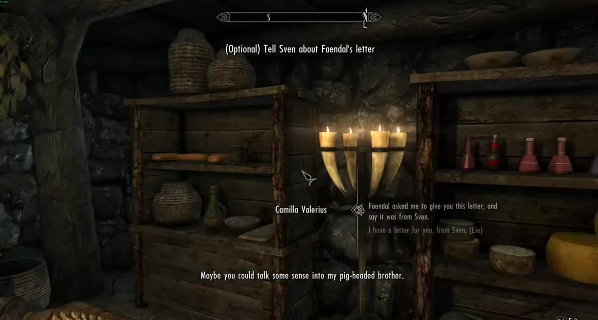

# skyrim-devtools

**skyrim-use**: an SKSE plugin, a Python client and an MCP server that let AI agents play, test mods in and
profile Skyrim Special Edition 1.7.104 (1.6.1170 also loads; see [profiling](docs/profiling.md#other-runtimes)). The plugin exposes a JSON-RPC API inside the game; the MCP server turns it
into tools Claude can call, the way browser-use does for a browser.

*Teaser (60 s): an agent sets up a character, fights, gets stuck on purpose, explores dialogue and watches the live profiler. Click to play.*

## Features

**Play and navigate**
- Start and stop the game (headless or windowed), load saves, recover from crashes and hung starts.
- Menus, console commands, keys, mouse and controls; dialogue, quest, inventory, UI-tree and message-box tools.
- Walking, turning, camera control; `nav_goto` with a navmesh/AI mode and a precise key-press mode, global
  gate-to-gate routes, blocker reports when a path fails.
- Ranged and melee combat primitives, a bounded `combat_fight` loop, line-of-sight and ballistic aim.
- Perception beyond screenshots: `world_inspect`, `world_models`, zoomed `screen_capture`, `game_setting`.

**Mod testing**
- `dialogue_topics` lists everything an NPC could say and why a line is blocked; `dialogue_explore` walks every branch.
- `coverage_start` / `coverage_report`: quest stages, dialogue infos and events a play session exercised.
- A live-test runner (`skyrim-devtools-livetest`) and a documented pipeline for sharing one test machine.

**Alerts and stuck detection**
- Every tool reply carries active alerts: quest stalled, action loops, combat stalemate, death loop, falling,
  blind camera, menu left open, low fps, crime, unreachable targets, stuck movement.
- Game health (threads, memory, responsiveness) for long sessions; `perf_check`, `perf_hitches` and frame stats.

**Video composer**
- `capture_start` / `narrate` / `capture_stop` record footage and a timeline; `skyrim-devtools-video` composes
  footage beside an "agent view" panel with idle stretches sped up, chapter cards, insets and alert banners.

## Quickstart

Requirements: a legally owned Skyrim SE 1.7.104 copy (never shipped here), a Windows x64 machine with
[SKSE 2.3.1](https://skse.silverlock.org/) and the
[Address Library](https://www.nexusmods.com/skyrimspecialedition/mods/32444) table `versionlib-1-7-104-0.bin`,
Visual Studio 2022 and CMake to build the plugin, and Python 3.13 on the machine that runs the agent.

1. **Build the plugin** (Windows): see [docs/setup.md](docs/setup.md) for dependencies and the CMake/Ninja commands.
   Put the DLL in `Data/SKSE/Plugins` of an isolated game copy with a disposable save.
2. **Host setup** (Windows): copy `windows/host.ps1`, install its scheduled task, point it at the game copy. Details in
   [docs/setup.md](docs/setup.md#offline-desktop-setup).
3. **Install the client** (the machine running the agent, which can be the same one):

   ~~~sh
   python3.13 -m venv .venv && . .venv/bin/activate
   pip install -e '.[video]'
   skyrim-devtools-smoke --config devtools.json --mode headless   # launch, load, menu round trips, shutdown
   ~~~

   `devtools.json` names an SSH alias for a remote host: `{"sshDestination":"skyrim-pc","localPort":48681}`.
4. **Connect the MCP server to Claude Code**:

   ~~~sh
   claude mcp add skyrim-use -- skyrim-use --config /path/to/devtools.json
   ~~~

## Example session

~~~text
game_start {headless: true}                      {"phase":"running","mode":"headless",...}
load_save {name: "Fixture"}                      {"loadEpoch":1,"success":true}
perf_check {}                                    fps 59.9, p99 16.8 ms, no hitches
quest_targets {quest: "MQ101"}                   objective and target location
nav_goto {goal: {...}, mode: "ai"}               {"id":6,...}
nav_wait {timeout_s: 100}                        {"done":true,"combat":false}
combat_fight {rounds: 80}                        outcome, rounds, damage taken
agent_alerts {}                                  [{"kind":"moveStuck","hint":"try another route, ..."}]
screenshot {}                                    (image)
game_stop {}                                     {"phase":"stopped","cleanExit":true}
~~~

## Documentation

- [docs/skyrim-use.md](docs/skyrim-use.md): tools, alerts, combat, perception, dialogue, performance, showcase video
- [docs/protocol.md](docs/protocol.md): JSON-RPC methods and events, how to add one
- [docs/mod-testing.md](docs/mod-testing.md): dialogue exploration and coverage
- [docs/test-pipeline.md](docs/test-pipeline.md): sharing one test machine between agents
- [docs/setup.md](docs/setup.md): build, host and runner setup, prior art
- [docs/playtests/](docs/playtests/): written playtest reports

## Legal and privacy

No game files, saves, binaries or dumps are in this repository; keep them, dependency builds and run logs
outside Git. The plugin is for offline, single-player testing on a copy you own. Profiles, traces and logs
contain game names (functions, forms, locations): keep them local and do not upload traces.

## License

MIT for the Python client, launcher, transport, scripts and tests; the Windows plugin adapter is GPL-3.0-or-later
through CommonLibSSE-NG; documentation is CC0 1.0. See [LICENSE](LICENSE) and [licenses/](licenses/).
Third-party components and prior art are listed in [docs/setup.md](docs/setup.md).
